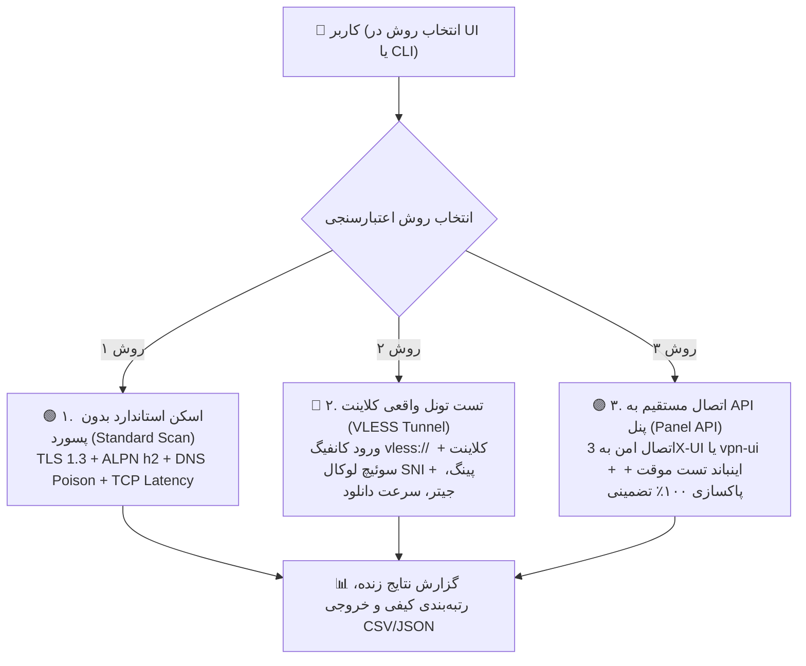
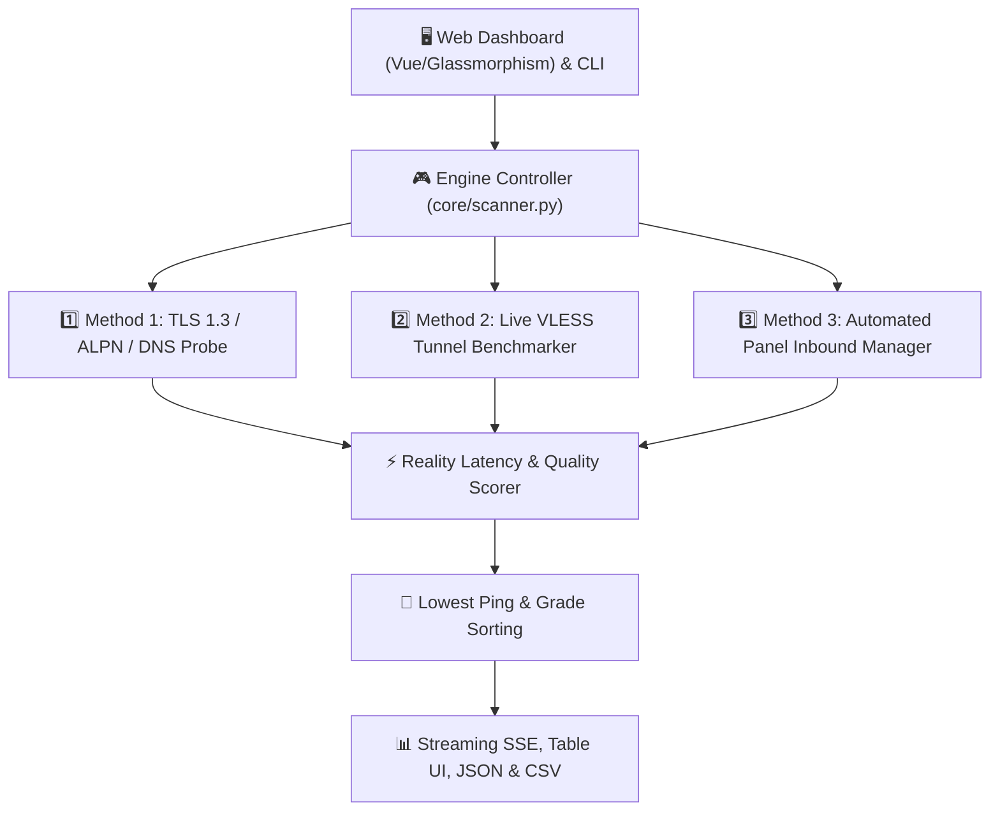

# ⚡️ SNI Scanner Pro (v2.2.0)
**اسکنر فوق‌حرفه‌ای و چندمنبعی SNI با ۳ روش اعتبارسنجی زنده برای دور زدن فیلترینگ و بهینه‌سازی VLESS Reality**

پروژه‌ای کاملاً مهندسی، بومی و بدون وابستگی به ابزارهای ناقص جهت تست، ارزیابی، اندازه‌گیری پینگ، جیتر واقعی (RFC 3550)، تست سرعت دانلود/آپلود و استخراج بهترین دامنه‌های SNI سازگار با سرورهای خارجی (به‌ویژه آلمان و فرانکفورت) روی شبکه اپراتورهای ایران (همراه اول، ایرانسل، رایتل و مخابرات).

---

## 🌟 ۳ روش اعتبارسنجی دامنه‌ها با حق انتخاب کامل کاربر

در نسخه ۲.۲.۰، کاربر هم در **داشبورد وب مدرن** و هم در **CLI ترمینال** حق انتخاب کامل دارد تا بسته به دسترسی و ترجیح امنیتی خود، یکی از ۳ متد زیر را انتخاب کند:



### 🟢 روش اول: اسکن استاندارد بدون نیاز به پسورد یا کانفیگ (Standard Scan)
- **مناسب برای:** کاربرانی که می‌خواهند سریع‌ترین و امن‌ترین اسکن را بدون ارائه هیچ‌گونه کانفیگ یا پسوردی انجام دهند.
- **نحوه عملکرد:** بررسی سلامت کامل TLS 1.3، پروتکل ALPN (`h2`)، تطابق گواهی SSL (SAN Matching)، عدم آلودگی DNS و اندازه‌گیری دقیق تاخیر زمانی (Latency).

### 🔵 روش دوم: تست تونل واقعی با کانفیگ VLESS کلاینت (VLESS Client Tunnel)
- **مناسب برای:** کاربرانی که لینک کانفیگ کلاینت خود (`vless://...`) را دارند و می‌خواهند بدون تغییر در سمت سرور، عبور ترافیک واقعی را روی سیستم خود بسنجند.
- **نحوه عملکرد:** ابزار کانفیگ VLESS Reality را تجزیه کرده، هسته محلی (Xray/Sing-box) را به صورت ایزوله اجرا می‌کند، نام‌های مختلف SNI را تزریق کرده و معیارهای حقیقی را می‌سنجد:
  - تأخیر واقعی تونل (Tunnel Latency RTT)
  - نوسان پینگ یا جیتر بر اساس استاندارد **RFC 3550** (Jitter Variance)
  - سرعت دانلود واقعی (Download Throughput Mbps)
  - میزان پکت‌لاست و پایداری اتصال.

### 🟣 روش سوم: تست خودکار با API پنل سرور (Automated Panel API)
- **مناسب برای:** مدیران سرور که می‌خواهند خودکارترین ارزیابی را با پنل‌های `3X-UI` یا `vpn-ui` تجربه کنند.
- **نحوه عملکرد:** اتصال از طریق REST API به پنل، ساخت یک اینباند VLESS Reality موقت روی پورت اختصاصی، سوئیچ هوشمند کاندیداهای SNI، و **تضمین ۱۰۰٪ حذف اینباند موقت** (Garbage Collection via Async Context Manager) حتی در صورت لغو یا بروز خطای پیش‌بینی‌نشده.

---

## 📥 دانلود و راه‌اندازی سریع با یک دستور (Quick Start via Git)

کافی است دستور متناسب با سیستم‌عامل خود را در ترمینال کپی و اجرا کنید تا پروژه دانلود شده و مستقیماً بالا بیاید:

### 🔹 در ویندوز (PowerShell یا CMD):
```powershell
git clone https://github.com/exelite-dev/sni-scanner.git; cd sni-scanner; .\run_web.bat
```

### 🔹 در لینوکس و مک (Linux / macOS):
```bash
git clone https://github.com/exelite-dev/sni-scanner.git && cd sni-scanner && chmod +x run.sh && ./run.sh
```

### 🔹 با داکر (Docker One-Liner):
```bash
git clone https://github.com/exelite-dev/sni-scanner.git && cd sni-scanner && docker compose up -d
```
> سپس در مرورگر آدرس `http://127.0.0.1:8787` را باز کنید.

---

## 🚀 راهنمای دستورات خط فرمان (CLI Examples)

```powershell
# ۱. اسکن استاندارد ۱۰۰ دامنه با مرتب‌سازی کمترین پینگ
python cli.py --method standard --category mega_all --limit 100 --sort-by latency

# ۲. تست تونل واقعی با کانفیگ VLESS
python cli.py --method vless_client --vless "vless://uuid@server:443?security=reality&sni=test.com&pbk=key..." --category german_european_mega

# ۳. تست خودکار با API پنل 3X-UI
python cli.py --method panel_api --panel-url "http://vps-ip:2053" --panel-user admin --panel-pass password --category netherlands_core
```

---

## 🧪 تست و پایداری ۱۰۰٪ مهندسی (Automated Test Suite)

پروژه به دو سوییت تست اختصاصی با **مجموع ۶۶ تست خودکار** مجهز است:
- **`tests/test_suite_37.py` (۳۷ تست):** اعتبارسنجی کامل ورودی‌ها، پاکسازی دامنه‌ها، دیتابیس محلی Tranco، هوش جغرافیایی GeoIP، تشخیص مسمومیت DNS، پروتکل TLS 1.3 و وب API.
- **`tests/test_suite_29_methods.py` (۲۹ تست):** تست کامل هر ۳ متد اعتبارسنجی، تجزیه‌گر VLESS، کلاینت Xray، استاندارد RFC 3550 جیتر، REST API پنل و تضمین حذف اینباند موقت.

```bash
# اجرای تمامی ۶۶ تست
python -m unittest discover -s tests -p "test_suite_*.py"
```

---

## 🏗 دیاگرام معماری چندلایه (System Architecture)


