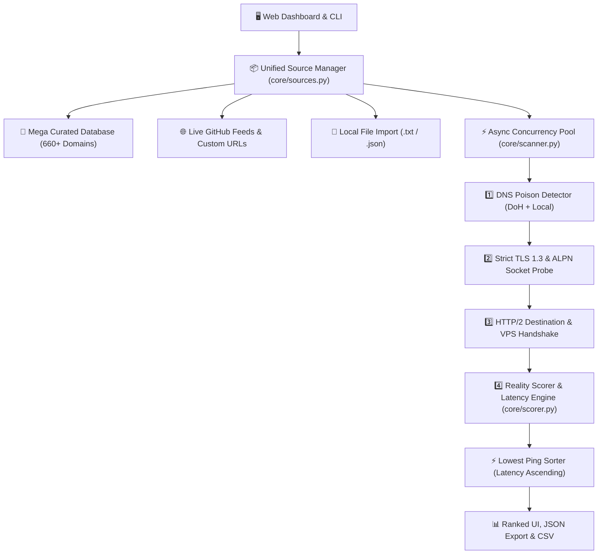

# ⚡️ SNI Scanner Pro (v2.1.0)
**اسکنر فوق‌حرفه‌ای و چندمنبعی SNI برای دور زدن فیلترینگ و پیکربندی VLESS Reality**

پروژه‌ای کاملاً مهندسی، بومی و بدون وابستگی به ابزارهای ناقص جهت تست، ارزیابی، اندازه‌گیری پینگ و استخراج بهترین دامنه‌های SNI سازگار با سرورهای خارجی (به‌ویژه آلمان و فرانکفورت) روی شبکه اپراتورهای ایران (همراه اول، ایرانسل، رایتل و مخابرات).

---

## 🌟 قابلیت‌های کلیدی نسخه ۲.۱.۰

1. **متصل به مگا-دیتابیس (بیش از ۶۶۰ دامنه طلایی + منابع آنلاین):**
   - دیتابیس جامع آفلاین در ۹ دسته‌بندی تخصصی (آلمان و اروپا، CDNهای جهانی، مایکروسافت/آژور، اپل، دولوپر، گیمینگ، فین‌تک، و...).
   - اتصال زنده به فیدهای گیت‌هاب (فید اختصاصی AmirH3bashi و مخازن رسمی v2fly).
   - امکان وارد کردن لینک مستقیم آنلاین (Custom URL) یا فایل متنی دامنه‌ها (`.txt` یا `.json`).
2. **مرتب‌سازی دقیق بر اساس کمترین پینگ (Lowest Ping First):**
   - اولویت‌بندی مطلق دامنه‌های سالم و بدون آلودگی DNS با کمترین تأخیر زمانی (Latency & TCP Ping).
   - امکان تغییر لحظه‌ای نحوه سورت به بالاترین امتیاز Reality در پنل وب و CLI.
3. **فیلتر سه‌مرحله‌ای DNS Poisoning:**
   - استعلام موازی DNS لوکال در برابر DoH امن (Cloudflare & Google) و فیلتر کردن رنج‌های آلوده ایران (`10.10.34.x`).
4. **تست عمیق TLS 1.3 و ALPN (`h2`):**
   - هندشیک سطح سوکت غیربلاک با پایتون `ssl.create_default_context` و استخراج کامل اطلاعات گواهی.
5. **شبیه‌سازی پروب Reality و اندازه‌گیری سازگاری با پورت مقصد سرور شما (`48.102.164.241:7`).**

---

## 🚀 روش‌های اجرا

### ۱. پنل وب پیشرفته (Web Dashboard)
دابل کلیک روی:
`run_web.bat`
یا اجرای دستور زیر در ترمینال:
```bash
python -m uvicorn web.app:app --host 127.0.0.1 --port 8787
```
سپس مرورگر را در آدرس `http://127.0.0.1:8787` باز کنید.

### ۲. محیط خط فرمان حرفه‌ای (Terminal CLI)
دابل کلیک روی:
`run_scanner.bat`
یا دستورات دلخواه در PowerShell:
```powershell
# اسکن ۱۰۰ دامنه از مگا-پول با مرتب‌سازی کمترین پینگ
python cli.py --category mega_all --limit 100 --sort-by latency

# اسکن دیتاسنترهای آلمان با همزمانی بالا
python cli.py --category german_european_mega --concurrency 25

# اسکن دامنه‌های سفارشی
python cli.py --domains speedtest.net,hetzner.com,cloudflare.com --sort-by latency
```

---

## 🏗 دیاگرام معماری سیستم (System Architecture)


